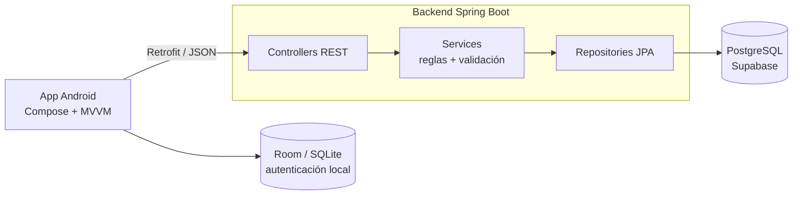

# GestionEcogarzones - Aplicación Móvil + Microservicios


## Desarrollador
*   **Matias Toloza Chaparro**
*   **Asignatura:** Desarrollo de Aplicaciones Móviles - Sección 010D
*   **Carrera:** Ingeniería en Informática - Duoc UC sede Maipú
*   **Profesora:** Viviana Poblete

## Contexto del Negocio
Ecogarzones es una Pyme con más de seis años de trayectoria continua en el rubro de banquetería y producción de eventos sociales y corporativos en la Región Metropolitana (cumpleaños, matrimonios, cenas corporativas y activaciones de marca). La empresa ofrece una amplia oferta integral que abarca la provisión de garzones, bartenders, cocineros, coperos, animadores y supervisores de logística. Su propuesta de valor se basa en la cordialidad, la excelencia operativa y la adaptabilidad a las necesidades específicas del cliente.

## Problema y Necesidades
El modelo operativo actual presenta severos cuellos de botella e ineficiencias críticas:
*   **Tiempos de gestión elevados:** Cotizaciones por múltiples rondas de chat o llamadas, causando demoras y pérdida de clientes.
*   **Discrepancias y errores:** Omisiones respecto a restricciones alimentarias, número de invitados o insumos.
*   **Baja trazabilidad:** Falta de un panel centralizado para auditar eventos en simultáneo, horarios y control de insumos.
*   **Escalamiento complejo:** El cliente no identifica a quién dirigirse ante una incidencia en terreno.

## Objetivo del Proyecto
Digitalizar y automatizar el catálogo de servicios, permitiendo cotizaciones instantáneas y transparentes. Además, dotar al equipo en terreno y a la administración de una plataforma nativa Android, respaldada por microservicios REST, que otorgue visibilidad del flujo del servicio, control de inventario y reporte ágil de incidencias con evidencia fotográfica.

---

## Arquitectura General

El proyecto se compone de **dos repositorios/módulos**:

| Módulo | Tecnología | Descripción |
|---|---|---|
| `GestionEcogarzones` (este repo) | Kotlin, Jetpack Compose, MVVM, Room, Retrofit | Aplicación Android nativa |
| `ecogarzones-backend` | Spring Boot 3.3.5, Java 17, JPA, PostgreSQL | Microservicios REST desplegables en la nube |



> Los diagramas completos (arquitectura de microservicios y arquitectura del proyecto Android) están en la rama `documents` y en `ecogarzones-backend/docs/arquitectura.md`.

---

## Roles de Usuario

El rol se asigna automáticamente según el dominio del correo (el usuario no puede elegirlo; el registro público siempre crea un **Cliente**).

| Rol | Dominio del correo | Acceso |
|---|---|---|
| **Cliente** | cualquier otro (gmail, outlook, etc.) | Cotizar eventos, reportar problemas, perfil |
| **Trabajador (Personal)** | `@personalecogarzones.com` | Panel operativo: eventos, incidencias, inventario (stock), checklist, perfil |
| **Administrador** | `@adminecogarzones.com` | Panel completo: finanzas, inventario (CRUD), usuarios, turnos, feedback |

La navegación se gestiona según el rol al iniciar sesión (`Login` → `Inicio` para clientes, `PanelAdmin` para personal/administradores).

---

## Funcionalidades Implementadas

### Autenticación y Perfil (todos los roles)
*   Inicio de sesión, registro y **cierre de sesión**.
*   Autenticación gestionada con **SQLite (Room)**; las contraseñas se almacenan con hash SHA-256 (con migración automática de cuentas antiguas en texto plano).
*   Detección visual del rol al escribir el correo.
*   Perfil editable (nombre, teléfono, dirección, cargo) con foto desde **cámara o galería**.
*   Formularios validados (correo, largo de contraseña, confirmación, campos obligatorios).

### Módulo de Cliente
*   **Cotización Inteligente:** formulario de eventos con calendario nativo (fecha mínima de 15 días), dirección y tipo de servicio (Banquetería Completa, Cóctel / Coffee Break, Solo Barra).
*   **Cálculo Automático de Personal:** sugerencia en tiempo real de garzones, cocineros, bartenders y coperos según el número de invitados.
*   **Selección de Menús y Barras:** catálogo con detalle de platos/bebidas y validación de cantidades vs. invitados.
*   **Logística de Insumos:** selección de quién provee qué.
*   **Resumen y Confirmación:** revisión previa al envío, pantalla de éxito animada y mensaje de contacto (48 hrs).
*   **Reporte de Incidencias:** envío de reportes con foto desde cámara o galería.
*   **Contacto directo:** accesos a WhatsApp, Instagram y correo de la empresa.

### Módulo de Administración / Personal
*   **Dashboard:** métricas de eventos totales, pendientes, activos, incidencias abiertas e invitados (el valor financiero del inventario solo lo ve el Administrador).
*   **Gestión de Eventos:** cambio de estado (Pendiente, Confirmado, En Proceso, Finalizado, Cancelado), asignación de personal/turnos con **notificación local**, checklist pre-evento y registro de feedback/calificación del cliente.
*   **Gestión de Incidencias:** listado, cambio de estado (Reportada, En Proceso, Resuelta), creación con evidencia fotográfica y visualización en pantalla completa.
*   **Control de Inventario:** ajuste de stock (ambos roles); alta y edición completa de ítems con categoría, unidad, costo unitario y proveedor (solo Administrador), con **Valor Total del Inventario** formateado como moneda.
*   **Gestión de Usuarios (solo Administrador):** listado con búsqueda y filtros por rol.

### Recursos Nativos Integrados
| Recurso | Uso |
|---|---|
| Cámara (FileProvider) | Evidencia de incidencias y foto de perfil |
| Galería | Adjuntar imágenes a reportes y perfil |
| Calendario nativo (DatePicker) | Fecha del evento |
| Notificaciones | Aviso al asignar turnos al personal |
| Intents (WhatsApp, Instagram, correo) | Contacto con la empresa |

---

## Microservicios (Backend Spring Boot)

API REST con capas `Controller → Service → Repository`, validaciones con Bean Validation y manejo centralizado de errores (`GlobalExceptionHandler`). Las contraseñas se almacenan con **BCrypt** y nunca se exponen en las respuestas.

| Método | Ruta | Descripción |
|---|---|---|
| POST | `/api/usuarios/registro` | Registra usuario (rol según dominio del correo) |
| POST | `/api/usuarios/login` | Autentica |
| GET | `/api/usuarios` | Lista usuarios |
| PUT | `/api/usuarios/perfil?email=` | Actualiza perfil |
| GET / POST | `/api/solicitudes` | Lista / crea solicitudes |
| GET / PUT | `/api/solicitudes/{id}` | Detalle / actualiza (estado, personal, checklist, feedback) |
| GET / POST | `/api/incidencias[?solicitudId=]` | Lista / crea incidencias |
| PUT | `/api/incidencias/{id}` | Actualiza incidencia (estado) |
| GET / POST | `/api/inventario` | Lista / crea ítems |
| PUT | `/api/inventario/{id}` | Edita ítem / stock |

### Pruebas Unitarias (JUnit 5 + Mockito + H2)
*   `SolicitudControllerTest`: creación válida (201), invitados en 0 (400), teléfono inválido (400), solicitud inexistente (404).
*   `SolicitudRepositoryTest`: orden por fecha de creación y estado por defecto.
*   `UsuarioServiceTest`: rol por dominio, hash de contraseña, correo duplicado (409), login correcto e incorrecto (401).

```bash
cd ecogarzones-backend
mvn test
```

### Ejecución del Backend
```bash
cd ecogarzones-backend
mvn spring-boot:run        # API en http://localhost:8080
```
La conexión a la base de datos se configura con variables de entorno (ver sección *Despliegue en la nube*). Con `app.seed.enabled=true`, al primer arranque se cargan usuarios e inventario de prueba.

---

## Despliegue en la Nube
*   **Base de datos:** PostgreSQL en **Supabase**.
*   **Backend:** contenedor Docker (`ecogarzones-backend/Dockerfile`) desplegable en Render, AWS u otro proveedor.
*   **Variables de entorno requeridas:**

| Variable | Ejemplo |
|---|---|
| `DB_URL` | `jdbc:postgresql://HOST:5432/postgres?sslmode=require` |
| `DB_USER` | `usuario` |
| `DB_PASSWORD` | `********` |
| `PORT` | Lo inyecta la plataforma automáticamente |

*   **Android → Backend:** la URL base se define en `RetrofitClient.kt` (`BASE_URL`). Para pruebas locales con emulador usar `http://10.0.2.2:8080/`; para producción, la URL pública del servicio (`https://TU-SERVICIO.onrender.com/`).

---

## Tecnologías

**Android**
*   Kotlin 2.0 · Jetpack Compose (Material Design 3) · MVVM
*   Room (SQLite) con Flows y corrutinas
*   Retrofit 2 + Gson + OkHttp Logging Interceptor
*   Navigation Compose · Coil · CameraX / FileProvider
*   minSdk 24 · targetSdk 35

**Backend**
*   Java 17 · Spring Boot 3.3.5 (Web, Data JPA, Validation)
*   Spring Security Crypto (BCrypt) · Lombok
*   PostgreSQL (producción) · H2 (pruebas)
*   JUnit 5 + Mockito · Docker

---

## Estructura del Proyecto

**Android**
```text
com.example.gestionecogarzones/
├── data/
│   ├── local/          # Entidades, DAOs y base de datos Room
│   ├── remote/         # ApiService, RetrofitClient y DTOs (Retrofit)
│   └── repository/     # Repositorio central
├── ui/
│   ├── components/     # Componentes reutilizables (campos validados)
│   ├── navigation/     # Rutas de navegación
│   ├── screens/        # Pantallas (login, perfil, admin, cliente)
│   └── theme/          # Colores corporativos y tipografía
├── utils/              # NotificationHelper, PasswordHasher, FileUtils
├── viewmodel/          # Lógica de presentación (MVVM)
└── MainActivity.kt     # Entry point y NavHost
```

**Backend**
```text
ecogarzones-backend/
├── src/main/java/com/ecogarzones/backend/
│   ├── config/         # AppConfig (BCrypt), DataSeeder
│   ├── controller/     # Endpoints REST
│   ├── dto/            # Requests / Responses
│   ├── exception/      # ApiException, GlobalExceptionHandler
│   ├── model/          # Entidades JPA y enums
│   ├── repository/     # Spring Data JPA
│   └── service/        # Reglas de negocio
├── src/test/           # Pruebas JUnit
├── docs/               # Diagramas de arquitectura
├── Dockerfile
└── docker-compose.yml
```

---

## Cuentas de Prueba

| Rol | Correo | Contraseña |
|---|---|---|
| Administrador | `matias@adminecogarzones.com` | `matias123` |
| Personal | `alan@personalecogarzones.com` | `alan123` |
| Cliente | `marcela@gmail.com` | `marcela123` |

---

## APK Firmada
La aplicación se genera como APK firmada digitalmente desde Android Studio (*Build → Generate Signed App Bundle / APK*). El archivo resultante se ubica en `app/release/app-release.apk`.

---

# (ENG) GestionEcogarzones - Mobile App + Microservices

A native Android application backed by Spring Boot microservices, developed for **Ecogarzones**, an SME specializing in catering and event management.

## Author
*   **Matias Toloza Chaparro**
*   **Subject:** Mobile App Development - Section 010D
*   **Degree:** Informatics Engineering - Duoc UC, Maipú campus
*   **Teacher:** Viviana Poblete

## Business Context
Ecogarzones is an SME with over six years of experience in catering and event production in the Metropolitan Region of Chile (birthdays, weddings, corporate dinners and brand activations). It provides waiters, bartenders, chefs, dishwashers, entertainers and logistics supervisors, focusing on cordiality, operational excellence and adaptability.

## Problem Statement
*   **High management times:** quotations require multiple rounds of chat or calls.
*   **Discrepancies and errors:** omissions about dietary restrictions, guest count or supplies.
*   **Low traceability:** no centralized dashboard for simultaneous events, schedules and supplies.
*   **Complex escalation:** clients don't know who to contact for on-site incidents.

## Project Goal
Digitalize the service catalog for instant, transparent quotations, and give on-site staff and administrators a native Android platform backed by REST microservices, with visibility of the service flow, inventory control and incident reporting with photographic evidence.

## Architecture
Two modules: the **Android app** (Kotlin, Jetpack Compose, MVVM, Room, Retrofit) and the **backend** `ecogarzones-backend` (Spring Boot 3.3.5, Java 17, JPA, PostgreSQL on Supabase). Full diagrams live in the `documents` branch and in `ecogarzones-backend/docs/arquitectura.md`.

## User Roles
The role is assigned from the e-mail domain (public sign-up always creates a **Client**):

| Role | E-mail domain | Access |
|---|---|---|
| **Client** | any other | Quote events, report problems, profile |
| **Staff** | `@personalecogarzones.com` | Operational panel: events, incidents, inventory (stock), checklist, profile |
| **Administrator** | `@adminecogarzones.com` | Full panel: finances, inventory CRUD, users, shifts, feedback |

## Implemented Features

### Authentication and Profile
*   Login, sign-up and **logout**, with authentication handled by **SQLite (Room)** and SHA-256 password hashing.
*   Editable profile with photo from camera or gallery.
*   Validated forms across the app.

### Client Module
*   **Smart Quotation:** event form with native date picker (15-day minimum), address and service type.
*   **Automatic Staff Calculation:** real-time suggestion based on guest count.
*   **Menu and Bar Selection:** catalog with exact quantities validated against guests.
*   **Supply Logistics**, **summary and confirmation** screen, and **incident reporting** with photos.
*   Direct contact via WhatsApp, Instagram and e-mail.

### Admin / Staff Module
*   **Dashboard** with events, pending/active events, open incidents and guests (inventory value visible only to Admin).
*   **Event Management:** status changes, shift assignment with **local notification**, pre-event checklist and client feedback.
*   **Incident Management:** status updates, creation with photo evidence and full-screen viewer.
*   **Inventory Control:** stock adjustment (both roles); full create/edit with unit cost and supplier (Admin only), with total inventory value.
*   **User Management (Admin):** searchable list with role filters.

### Native Resources
Camera (FileProvider), gallery, native DatePicker, local notifications and external intents (WhatsApp, Instagram, e-mail).

## Microservices
REST API with `Controller → Service → Repository` layers, Bean Validation, centralized error handling and BCrypt-hashed passwords. Endpoints: `/api/usuarios`, `/api/solicitudes`, `/api/incidencias`, `/api/inventario` (see table above).

**Unit tests (JUnit 5 + Mockito + H2):** controller validation (201/400/404), repository ordering and defaults, and user service (role by domain, hashing, duplicates, login).

```bash
cd ecogarzones-backend && mvn test
```

## Cloud Deployment
PostgreSQL on **Supabase**; backend packaged with Docker and deployable on Render/AWS. Configure `DB_URL`, `DB_USER` and `DB_PASSWORD` as environment variables. In Android, set `BASE_URL` in `RetrofitClient.kt` to the public service URL (`http://10.0.2.2:8080/` for the emulator).

## Technologies
*   **Android:** Kotlin, Jetpack Compose (Material 3), MVVM, Room, Retrofit, Navigation Compose, Coil, CameraX / FileProvider.
*   **Backend:** Java 17, Spring Boot 3.3.5, Spring Data JPA, Spring Security Crypto, Lombok, PostgreSQL, H2, JUnit 5, Mockito, Docker.

## Signed APK
Generated from Android Studio (*Build → Generate Signed App Bundle / APK*), output at `app/release/app-release.apk`.
