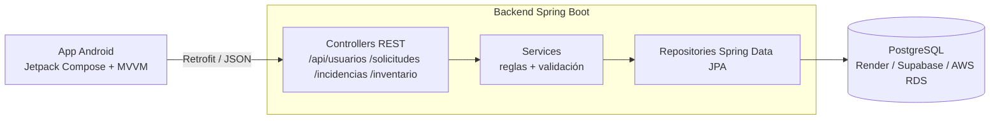
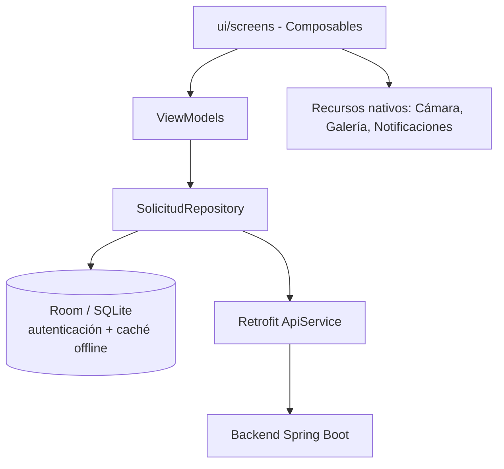

# Arquitectura Ecogarzones

## Microservicio (Spring Boot)

## Proyecto Android (MVVM)

## Endpoints
| Método | Ruta | Descripción |
|---|---|---|
| POST | /api/usuarios/registro | Registra usuario (rol según dominio del correo) |
| POST | /api/usuarios/login | Autentica |
| PUT | /api/usuarios/perfil?email= | Actualiza perfil |
| GET/POST | /api/solicitudes | Lista / crea |
| GET/PUT | /api/solicitudes/{id} | Detalle / actualiza (estado, personal, checklist, feedback) |
| GET/POST | /api/incidencias[?solicitudId=] | Lista / crea |
| PUT | /api/incidencias/{id} | Cambia estado |
| GET/POST | /api/inventario | Lista / crea |
| PUT | /api/inventario/{id} | Edita ítem / stock |
